<div align="center">

# ChatGPT Claude Sidebar

**English** · [简体中文](README.zh-CN.md)

**Reusable sidebar infrastructure for AI software developers**

Build your product. Reuse the AI interaction layer.


[Screenshots](#screenshots) · [Responsive layouts](#responsive-layouts) · [CLI connection](#connected-through-real-clis) · [Why this project](#why-this-project) · [Feature matrix](docs/features.md) · [Quick start](#quick-start) · [Integration](#integrate-with-your-software) · [Development guide](docs/development.md)

</div>

AI applications often need the same foundations: a conversation interface, model and tool connections, session management, permission requests, plans, and readable execution results.

**ChatGPT Claude Sidebar aims to make that work reusable, so developers can focus on their own products.** It starts with a standalone Electron sidebar connected to real Codex CLI and Claude Code workflows, and is being developed into a shared interface and runtime for different host applications.

> Development preview. The standalone window, CLI connections, and existing Electron host bridge are implemented. A unified host SDK and adapters for more applications are still in development.

## Screenshots

These screenshots show this project's actual standalone window. The conversations used real CLI calls to read a small, public tag utility. The captured interface uses the Chinese locale.

<table>
  <tr>
    <th width="50%">Codex · Dark</th>
    <th width="50%">Claude Code · Dark</th>
  </tr>
  <tr>
    <td></td>
    <td>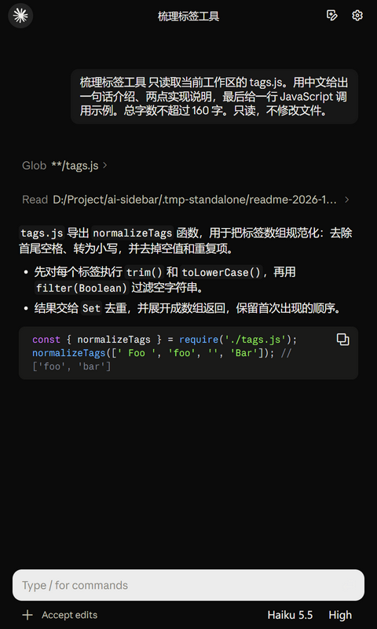</td>
  </tr>
</table>

<details>
<summary><strong>View light themes</strong></summary>
<br>

<table>
  <tr>
    <th width="50%">Codex · Light</th>
    <th width="50%">Claude Code · Light</th>
  </tr>
  <tr>
    <td>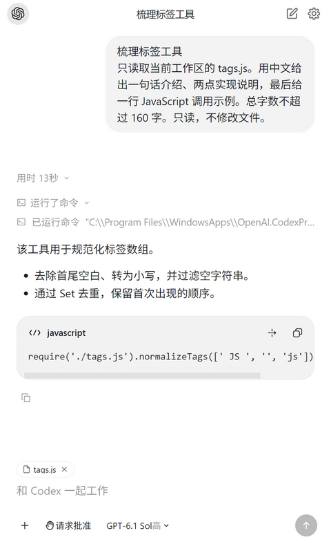</td>
    <td>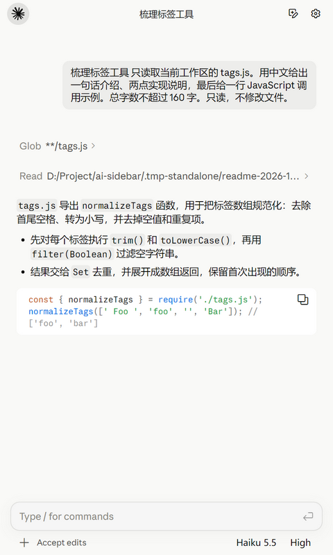</td>
  </tr>
</table>

</details>

### Switch between CLI providers

The top-left circular button shows the current CLI. Hover to expand the capsule, then **click the other icon to switch**. Each provider keeps its own conversations, drafts, and interface styles.

<p align="center">
  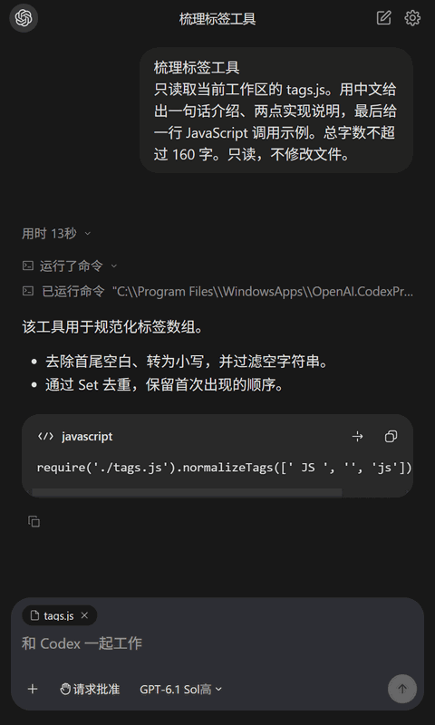
</p>

See the [media notes](docs/media/README.md) for capture details and real-call provenance.

## Responsive layouts

The sidebar adapts to a compact panel, a normal window, or a wide workspace. These are captures of **the same real conversation at four actual WebView widths**, rather than resized copies of one screenshot. Operating-system title bars are excluded.

| WebView width | What the layout demonstrates |
| --- | --- |
| **320 px** | Compact sidebar: text reflows, long titles truncate, and the input controls remain available. |
| **440 px** | Standard sidebar: conversation, tool activity, and composer share the available space. |
| **800 px** | Expanded panel: paragraphs and code have more horizontal room. |
| **1440 px** | Wide workspace: the reading column stays bounded, with margins on both sides. |

<p align="center"><a href="docs/media/codex-width-1440.png">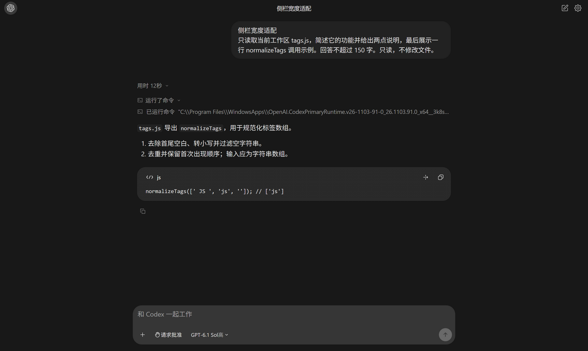</a></p>

<details>
<summary><strong>Compare 320 / 440 / 800 / 1440 px · Codex and Claude</strong></summary>
<br>

<h3>Codex</h3>
<table>
<tr><th width="50%">320 px</th><th width="50%">440 px</th></tr>
<tr><td><a href="docs/media/codex-width-320.png">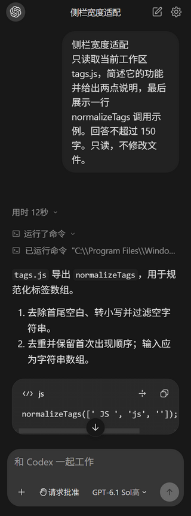</a></td><td><a href="docs/media/codex-width-440.png">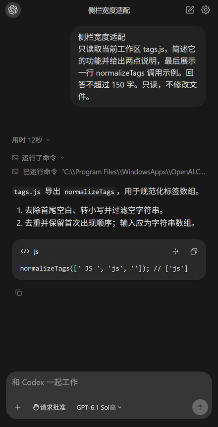</a></td></tr>
</table>
<table>
<tr><th width="50%">800 px</th><th width="50%">1440 px</th></tr>
<tr><td><a href="docs/media/codex-width-800.png">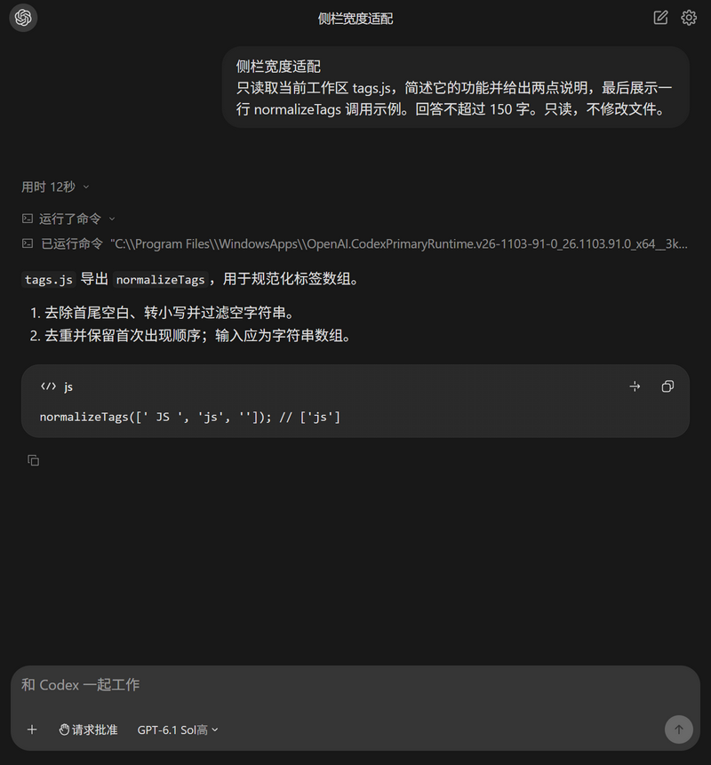</a></td><td><a href="docs/media/codex-width-1440.png"></a></td></tr>
</table>
<h3>Claude Code</h3>
<table>
<tr><th width="50%">320 px</th><th width="50%">440 px</th></tr>
<tr><td><a href="docs/media/claude-width-320.png">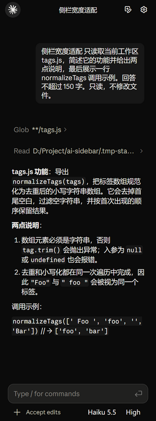</a></td><td><a href="docs/media/claude-width-440.png">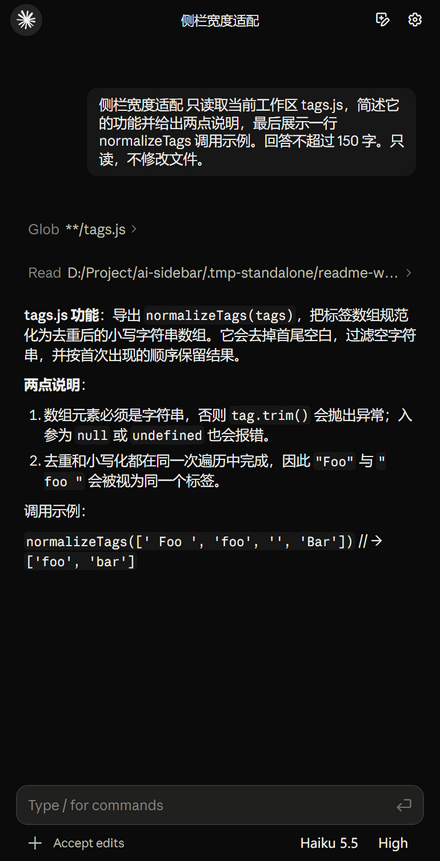</a></td></tr>
</table>
<table>
<tr><th width="50%">800 px</th><th width="50%">1440 px</th></tr>
<tr><td><a href="docs/media/claude-width-800.png">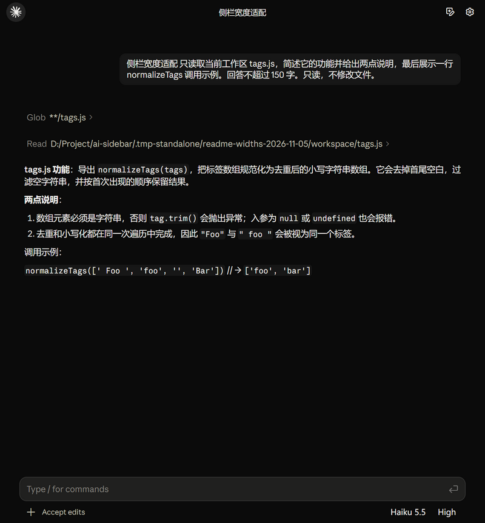</a></td><td><a href="docs/media/claude-width-1440.png">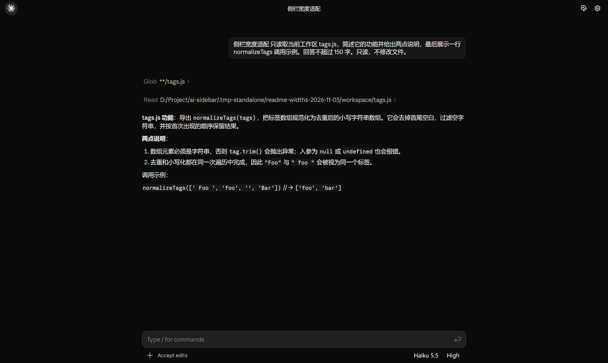</a></td></tr>
</table>
</details>

Both providers were checked at all four widths. The page did not overflow horizontally; code blocks can retain their own horizontal scroll area. Each provider keeps its own layout rules. This is a desktop-width demonstration, not a claim of mobile-device support. Open any image to inspect it at full resolution.

## Why this project

AI products serve different purposes, but much of their interaction infrastructure is similar. Editors, readers, knowledge tools, and developer tools repeatedly need to solve the same problems.

| Repeated work | Foundation to reuse |
| --- | --- |
| Building another chat window for every product | A sidebar that runs independently and can be embedded in a host |
| Handling CLI startup, connections, and streaming events | A CLI runtime with clear lifecycle and event boundaries |
| Rebuilding conversations, drafts, and history recovery | Reusable session management |
| Creating one-off interfaces for tools, approvals, and plans | Clear, interactive views of task execution |
| Reimplementing file and context integration | A bridge through which the host supplies context and actions |

The focus is **reducing duplicate work for AI software developers**. The standalone window is a place to develop, verify, and demonstrate these capabilities. The longer-term goal is a reusable foundation that different AI applications can integrate.

## What works today

| Capability | Current implementation |
| --- | --- |
| **Two CLI backends** | Codex app-server; Claude Agent SDK with the local Claude Code execution workflow |
| **Conversation and execution views** | Streaming responses, thinking and tool activity, code blocks, file changes, and structured reviews |
| **Interactive task controls** | Permission requests, user questions, plan viewing and confirmation, send and stop |
| **Session management** | Recent conversations grouped by project, search, history opening, per-session drafts, and recovery |
| **File context** | File drag and drop, attachment display, and context supplied by the host |
| **Separate interface systems** | Independently maintained Codex and Claude components and styles, each with dark and light themes |
| **Traceable UI sources** | Import scripts, version manifests, component hashes, and host adapters |
| **Standalone and existing embedding entry points** | Electron preview window, runtime registration, preload bridge, and iframe host bridge |

Coverage is still expanding. See the [Codex connection guide](docs/codex-connection.md), [UI source notes](docs/ui-reference.md), and [conversation-menu integration record](docs/navigation-2026-11-04.md) for specific operations and validation boundaries. These supporting documents are currently in Chinese.

## Feature highlights

### Models and reasoning effort follow the active CLI

Model catalogs come from the current CLI. Each provider has its own model menu and effort controls. Actual model access depends on the CLI and account.

<table>
  <tr><th width="50%">Codex · Model and effort</th><th width="50%">Claude Code · Model catalog</th></tr>
  <tr>
    <td>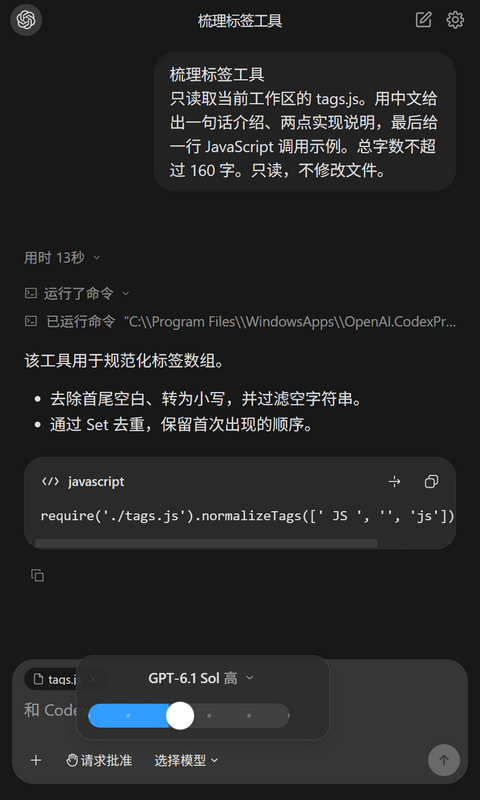</td>
    <td>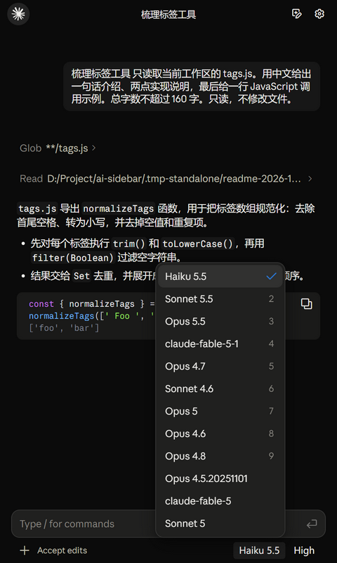</td>
  </tr>
</table>

### Approve actions, answer questions, and confirm plans

Actions that need a user decision have dedicated interaction views. The following screenshots come from real CLI validation on November 2, 2026.

<table>
  <tr><th>Permission request</th><th>User question</th><th>Plan confirmation</th></tr>
  <tr>
    <td>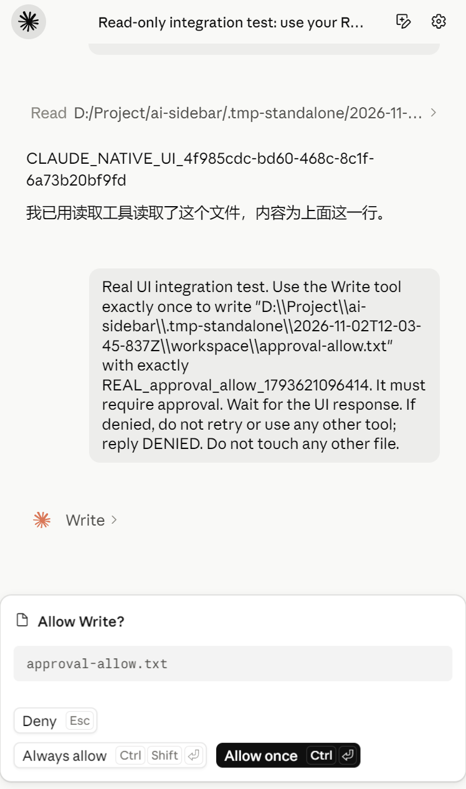</td>
    <td>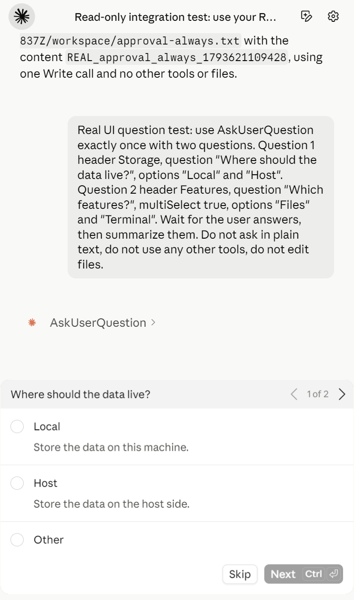</td>
    <td>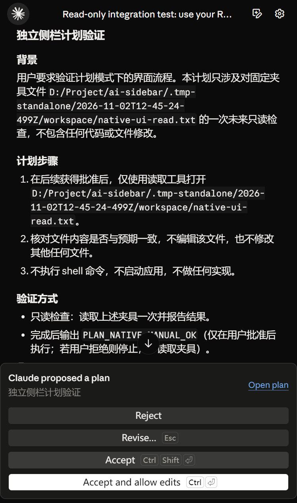</td>
  </tr>
</table>

<details>
<summary><strong>View conversation menus, file context, and slash commands</strong></summary>
<br>

Each provider opens its own recent-conversation menu, with grouping, search, and recovery based on actual project paths.

<table>
  <tr><th width="50%">Codex · Projects and conversations</th><th width="50%">Claude Code · Projects and conversations</th></tr>
  <tr>
    <td>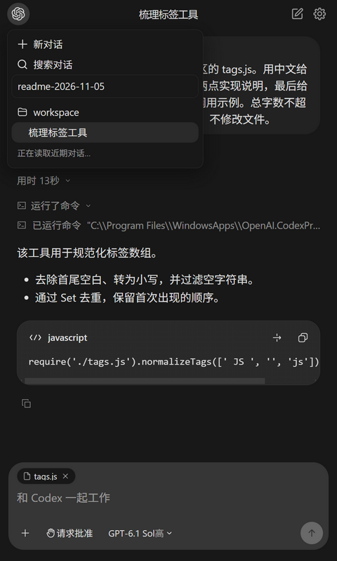</td>
    <td>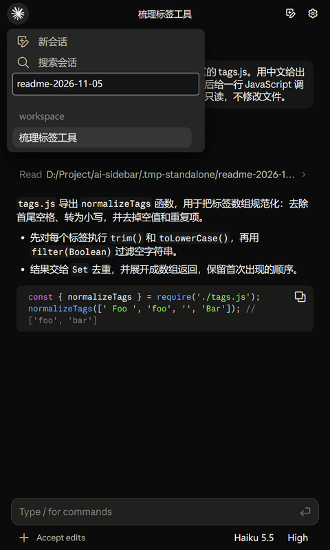</td>
  </tr>
</table>

Added files appear as context chips. Type / to see commands supported by the active provider.

<table>
  <tr><th width="50%">File context</th><th width="50%">Slash commands</th></tr>
  <tr>
    <td>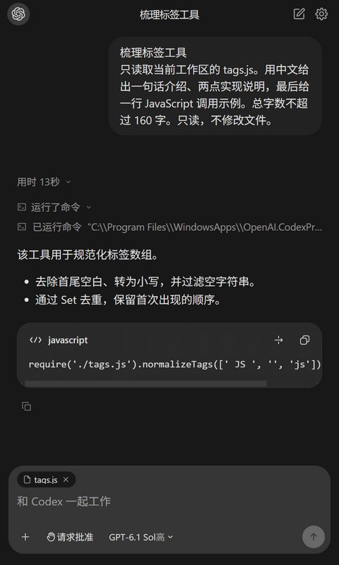</td>
    <td>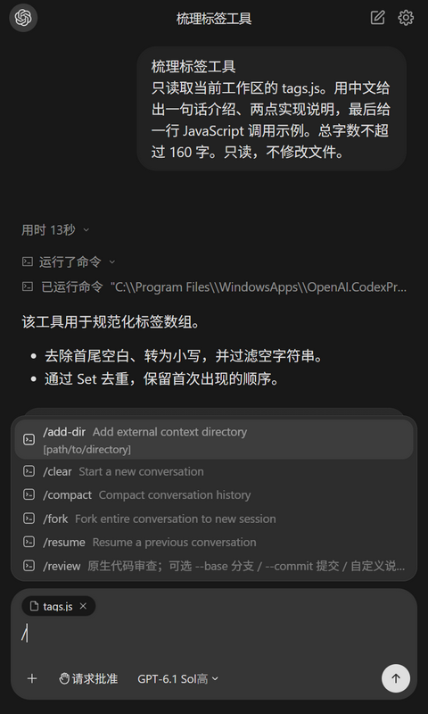</td>
  </tr>
</table>

</details>

## Feature checklist

- **Runtime and integration:** standalone Electron window, workspace selection, separate configuration profiles, runtime registration, resource lookup, IPC / iframe bridges, host context, and shutdown cleanup.
- **Task execution:** two CLI connections, native account configuration, streaming, send and stop, tool inputs and outputs, command records, error states, native usage reporting, and queuing.
- **Conversations:** multiple sessions, project grouping, search, collapse, drafts, scroll positions, history recovery, close and reopen, and forking; Codex native pagination, renaming, archiving, goals, and queue operations.
- **Content:** Markdown, tables, syntax highlighting and copying, math, tool activity, file changes, turn diffs, structured reviews, automatic scroll following, and return to bottom.
- **Interaction:** permission requests, native decision options, single- and multiple-choice questions, supplemental answers, multiple-question navigation, plan viewing, confirmation, rejection, and revision feedback.
- **Input and context:** file drag and drop, image attachments, paste, file / folder context, attachment removal, slash commands, and agent / skill mentions.
- **Models and settings:** model-catalog synchronization, model and effort selection, permission preferences, separate dark and light themes, remembered appearance, font and input settings, path and connection diagnostics, and Codex account and usage views.
- **Extensions and maintenance:** MCP configuration and connection tests; provider resource entry points for commands, agents, skills, hooks, and plugins; UI-resource import checks; real CLI validation; and UI debugging examples.

**[Full feature matrix and provider differences →](docs/features.md)** The detailed matrix is currently in Chinese. Some capabilities are provider-specific; the unified host SDK, complete protocol coverage, and full cross-platform validation are still in development.

## Connected through real CLIs

The sidebar is an interaction layer over local coding-agent runtimes. Codex uses the local `codex app-server` process and JSON-RPC over stdio. Claude uses the bundled Agent SDK to run the configured local Claude Code executable. See the official [Codex app-server documentation](https://learn.chatgpt.com/docs/app-server) and [Claude Agent SDK overview](https://code.claude.com/docs/en/agent-sdk/overview) for these integration mechanisms.

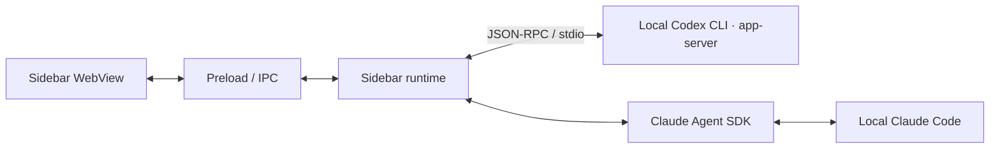

| Area | Codex CLI | Claude Code |
| --- | --- | --- |
| Connection | Child process, app-server handshake, RPC requests and event notifications | Agent SDK, configured local executable, streaming messages and control callbacks |
| Account and configuration | Local CLI configuration; account and rate-limit reads where supported | Configured CLI environment and SDK setting sources |
| Sessions | Native thread IDs, history, resume / fork, pagination, renaming and archiving | Native session IDs, resume / fork and local history discovery |
| Interaction | Tool events, approval and question requests, plans, diffs and reviews | Tool messages, permission callbacks, questions and plan interactions |
| Stop and cleanup | Interrupt the active turn and release the window's child processes | Abort / interrupt the active SDK query and release its execution resources |

### What this means for developers

- **Keep the execution workflow in the CLI.** The sidebar translates real events into conversation and tool views, then sends user decisions back to the runtime.
- **Use your existing CLI setup.** Authenticate with the corresponding CLI first. Sidebar model, effort, permission and workspace selections are passed into the execution workflow.
- **Keep session identity.** History reopening continues with the corresponding native thread or session ID instead of starting an unrelated chat.
- **See real results and usage.** Tool output, failures and token usage come from runtime events; missing usage is not reported as zero. Actual calls consume the configured account's quota.
- **Respect provider boundaries.** Model access, supported effort levels, approval options, tools and MCP availability depend on the CLI version, configuration and account. Not every native CLI feature has a sidebar control yet.

### Checked environment

| Component | Local version checked on November 5, 2026 |
| --- | --- |
| Codex CLI | 0.163.0 |
| Claude Code | 2.1.283 |
| Node.js | 24.13.0 |

These are recorded local versions, not hard version requirements. Imported desktop UI resource versions are tracked separately from CLI versions.

Before launching, confirm that the CLI you intend to use runs and is authenticated in your terminal. If it is not discovered automatically, check the provider's executable path and connection diagnostics in Settings. Complete any tool approval in the sidebar when requested. For supported Codex operations and compatibility limits, see the [connection guide](docs/codex-connection.md) and [feature matrix](docs/features.md) (Chinese).

## Quick start

### Prerequisites

- Node.js and npm; Node.js 24 is recommended.
- Codex CLI or Claude Code installed and authenticated. Use either or both as needed.
- Development and validation currently focus on Windows. Other platforms have not completed full validation.

Check that the CLI you want to use is available in your terminal:

```shell
codex --version
claude --version
```

### Launch the standalone sidebar

From the repository root:

```shell
git clone https://github.com/Hemistic/chatgpt-claude-sidebar.git
cd chatgpt-claude-sidebar
npm ci
npm start
```

Use a specific workspace:

```shell
npm start -- --workspace="D:/Projects/my-app"
```

For an initial launch, you can choose Claude as the starting provider:

```shell
npm start -- --provider=claude --workspace="D:/Projects/my-app"
```

Existing conversations restore their saved local state. You can also switch CLI providers through the top-left capsule. Choose the model and reasoning effort in the interface; the product does not lock you to a particular model.

The sidebar uses your local CLI authentication and configuration. Launching the window establishes a connection; model turns start when you send a message. Real calls consume the corresponding account's quota.

## Integrate with your software

An Electron host can register the runtime and load the sidebar page. The repository has not been published as an npm package, so this example uses a local source path.

```js
const path = require('node:path');
const { pathToFileURL } = require('node:url');
const sidebar = require('/path/to/chatgpt-claude-sidebar');

const entry = sidebar.sourcePath('claudian-sidebar.html');
const runtime = sidebar.register(ipcMain, {
  projectRoot: workspacePath,
  electronDir: path.dirname(entry),
  defaultWorkspace: workspacePath,
  allowedEntryUrls: [pathToFileURL(entry).href],
});

// On host shutdown, release this window's CLI connections and processes.
await runtime.shutdown();
```

The page entry is `src/claudian-sidebar.html`; the preload entry is `src/claudian-sidebar-preload.js`. Set `surface=chat` for the chat view. The existing iframe entry uses `claudianSidebarHostBridge.attach()` to communicate with the host.

The host supplies a sidebar region and interfaces for files, context, and actions. **A unified, stable developer SDK is the next major infrastructure goal.** See the [architecture notes](docs/architecture.md) for current interfaces and integration boundaries.

## Roadmap

- [x] Provide a standalone Electron sidebar window.
- [x] Connect to real Codex and Claude execution workflows.
- [x] Establish conversation, tool, approval, question, and plan interactions.
- [x] Maintain separate provider interfaces, menus, and dark / light themes.
- [ ] Define clear, stable host interfaces and event contracts.
- [ ] Further separate the interface, session state, CLI runtime, and host capabilities.
- [ ] Add more host integration examples and adapters.
- [ ] Build a broader matrix for functional, rendering, performance, and long-task measurements.
- [ ] Improve releases, version compatibility, and upgrades.

## Development and validation

```shell
# Local regression checks; no model calls
npm test

# Real CLI smoke validation; consumes account quota
npm run test:live
```

Real validation checks CLI events, usage, rendered output, and screenshots. After inspection, test conversations are removed by their dedicated workspace and session IDs. See the [development guide](docs/development.md) for commands, repository layout, and maintenance details.

```text
chatgpt-claude-sidebar/
├── src/          Interface, CLI runtime, sessions, and host bridges
├── standalone/   Standalone window and real interaction validation
├── scripts/      Startup, UI-resource imports, and source checks
├── tests/        Local regression checks
├── docs/         Architecture, provenance, validation records, and media
└── index.cjs     Existing Node / Electron integration entry
```

## Sources and references

The extracted sidebar's origin is recorded in [PROVENANCE.json](PROVENANCE.json); related license notices are in [licenses/](licenses/). Imported Codex and Claude UI resources have separate version and hash records; see the [UI source notes](docs/ui-reference.md). This is not an official OpenAI or Anthropic product. Third-party resources retain their respective license terms.

The README's structure takes inspiration from [Cline](https://github.com/cline/cline/blob/main/README.md), [LobeHub](https://github.com/lobehub/lobehub/blob/main/README.md), and [lencx/ChatGPT](https://github.com/lencx/ChatGPT/blob/main/README.md): show the actual interface first, then explain capabilities, setup, and developer integration. The screenshots, animation, and copy were produced for this project.
