<div align="center">

# ChatGPT Claude Sidebar

[English](README.md) · **简体中文**

**面向 AI 软件开发者的可复用侧栏基础设施**

让每个 AI 软件，少重复做一套对话界面。


[界面预览](#界面预览) · [宽度适配](#不同宽度的适配) · [CLI 连接](#通过真实-cli-连接) · [项目定位](#为什么做这个项目) · [功能清单](docs/features.md) · [快速开始](#快速开始) · [接入自己的软件](#接入自己的软件) · [开发文档](docs/development.md)

</div>

很多 AI 软件都会遇到同一组需求：做一个对话入口，接上模型与工具，管理多轮会话，再把权限审批、计划和执行结果显示清楚。

**ChatGPT Claude Sidebar 希望把这些重复工作沉淀为公共基础，让开发者把精力放回自己的产品。** 当前从独立 Electron 侧栏起步，接入真实的 Codex CLI 与 Claude Code，逐步完善可以被不同宿主软件复用的界面与运行时。

> 当前为开发预览。独立窗口、CLI 连接和现有 Electron 宿主桥接已实现；统一宿主 SDK 与更多软件的适配仍在建设中。

## 界面预览

以下截图来自本项目实际运行的独立窗口。对话通过真实 CLI 完成，示例只读取一个公开的标签工具文件。

<table>
  <tr>
    <th width="50%">Codex · 深色</th>
    <th width="50%">Claude Code · 深色</th>
  </tr>
  <tr>
    <td>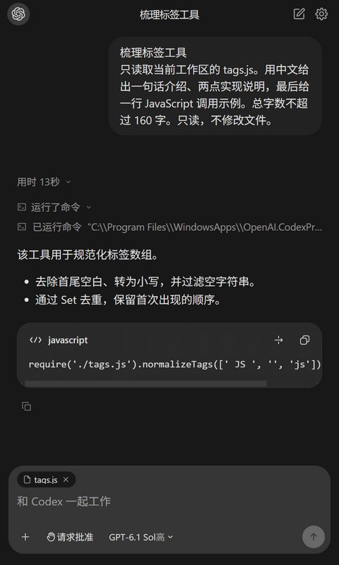</td>
    <td>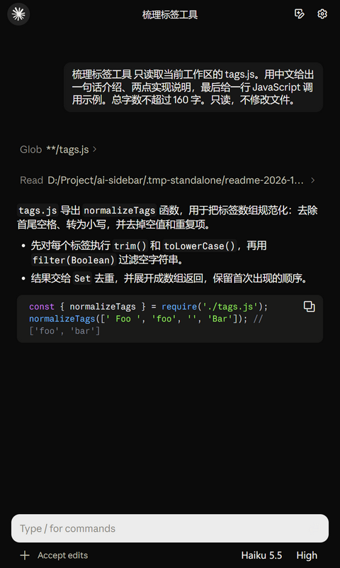</td>
  </tr>
</table>

<details>
<summary><strong>查看浅色主题</strong></summary>
<br>

<table>
  <tr>
    <th width="50%">Codex · 浅色</th>
    <th width="50%">Claude Code · 浅色</th>
  </tr>
  <tr>
    <td>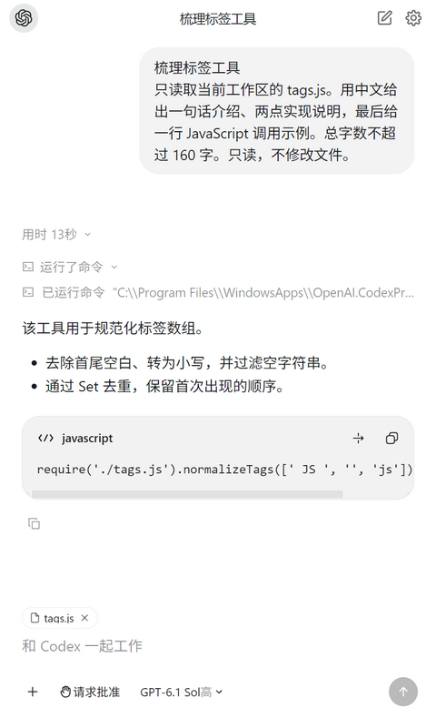</td>
    <td>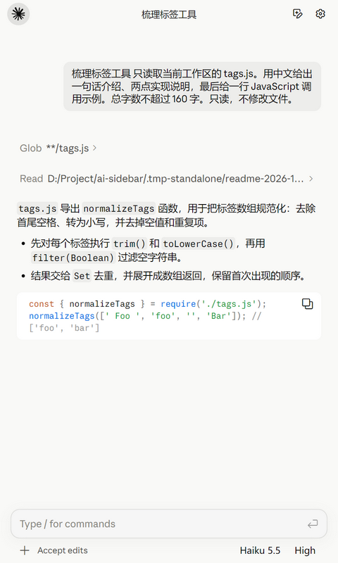</td>
  </tr>
</table>

</details>

### 在两种 CLI 之间切换

左上角默认显示当前 CLI 的圆形图标。悬停展开胶囊，**点击另一个图标才切换**；两边保留各自的对话、草稿与界面样式。

<p align="center">
  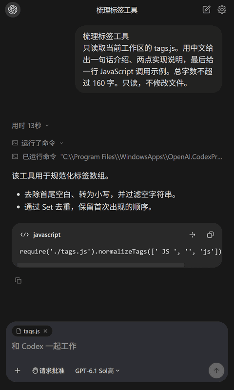
</p>

截图与 GIF 的录制方式、真实调用信息见 [展示素材说明](docs/media/README.md)。

## 不同宽度的适配

侧栏可以适应紧凑面板、普通窗口和宽屏工作区。下面是**同一段真实对话在四种实际 WebView 宽度下的截图**，并非把一张截图缩放成不同尺寸；图片均不包含系统窗口标题栏。

| WebView 宽度 | 展示的布局特性 |
| --- | --- |
| **320 px** | 紧凑侧栏：正文重新换行，长标题省略，输入控件保持可用。 |
| **440 px** | 标准侧栏：对话、工具活动和输入区共同利用可用空间。 |
| **800 px** | 展开面板：段落和代码获得更多横向空间。 |
| **1440 px** | 宽屏工作区：阅读列达到上限后保持宽度，左右保留留白。 |

<p align="center"><a href="docs/media/codex-width-1440.png">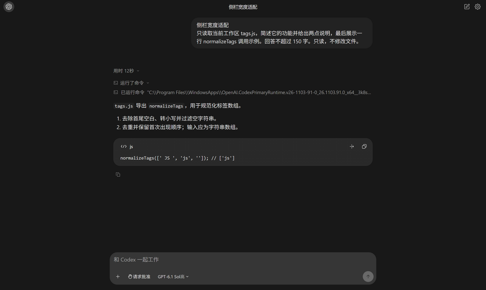</a></p>

<details>
<summary><strong>展开对比 320 / 440 / 800 / 1440 px · Codex 与 Claude</strong></summary>
<br>

<h3>Codex</h3>
<table>
<tr><th width="50%">320 px</th><th width="50%">440 px</th></tr>
<tr><td><a href="docs/media/codex-width-320.png">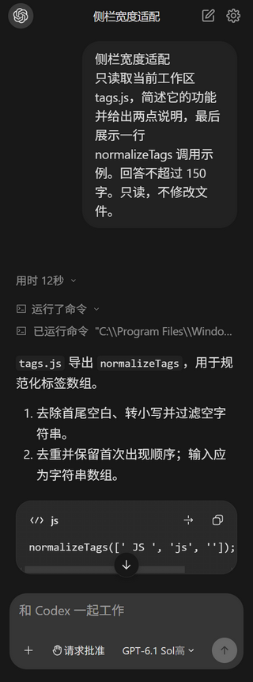</a></td><td><a href="docs/media/codex-width-440.png">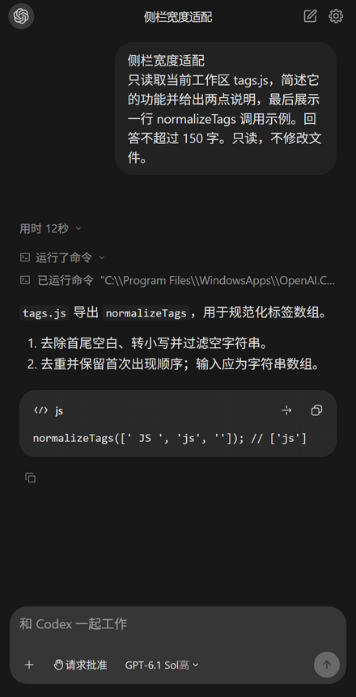</a></td></tr>
</table>
<table>
<tr><th width="50%">800 px</th><th width="50%">1440 px</th></tr>
<tr><td><a href="docs/media/codex-width-800.png">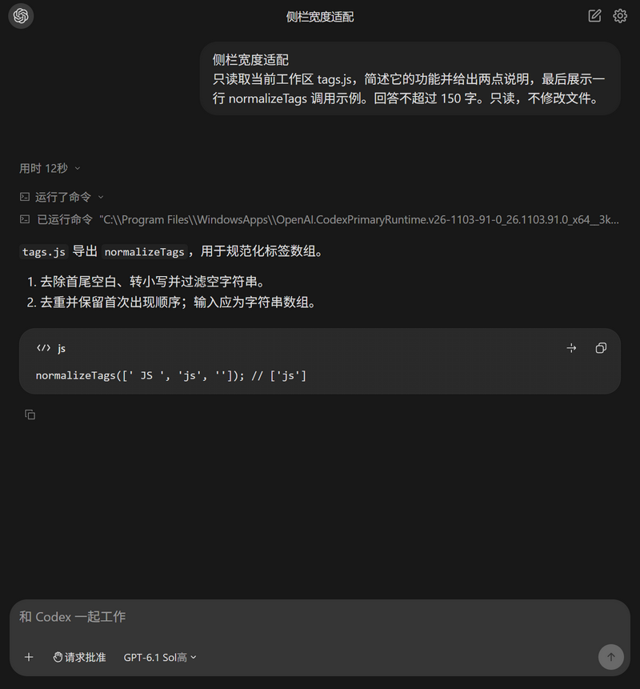</a></td><td><a href="docs/media/codex-width-1440.png"></a></td></tr>
</table>
<h3>Claude Code</h3>
<table>
<tr><th width="50%">320 px</th><th width="50%">440 px</th></tr>
<tr><td><a href="docs/media/claude-width-320.png">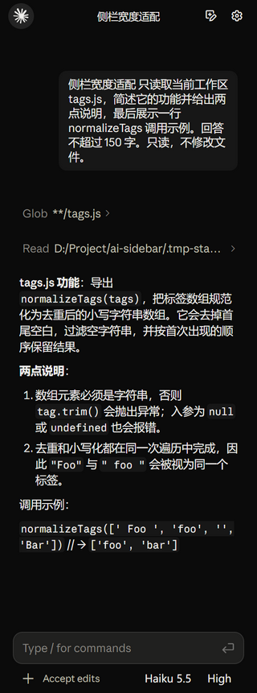</a></td><td><a href="docs/media/claude-width-440.png">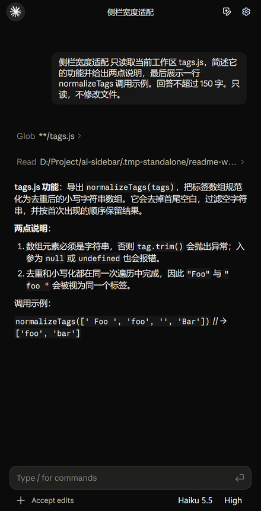</a></td></tr>
</table>
<table>
<tr><th width="50%">800 px</th><th width="50%">1440 px</th></tr>
<tr><td><a href="docs/media/claude-width-800.png">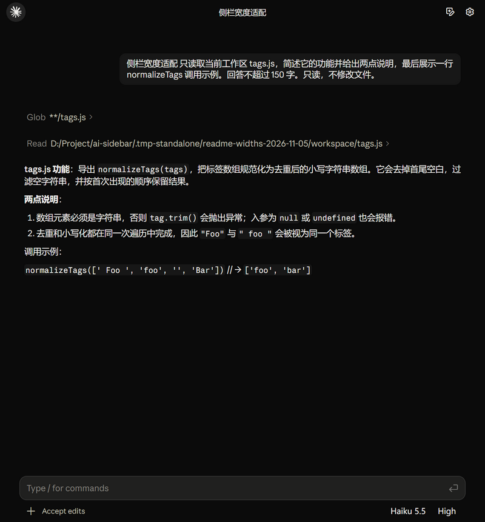</a></td><td><a href="docs/media/claude-width-1440.png">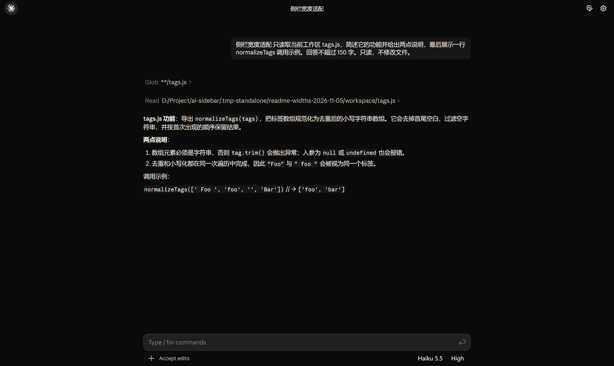</a></td></tr>
</table>
</details>

两个提供方均检查了上述四种宽度，页面没有整体横向溢出；代码块可以保留自身的横向滚动区域。两种提供方维持各自的布局规则。这是桌面窗口宽度展示，不代表已完成移动设备适配。点击图片可以查看原始尺寸。

## 为什么做这个项目

AI 软件的业务各不相同，基础交互却有很大一部分相似。编辑器、阅读器、知识管理工具和开发工具，往往都需要重复处理下面这些问题。

| 常见的重复工作 | 希望沉淀的基础能力 |
| --- | --- |
| 为每个产品重新制作聊天窗口 | 可独立运行、可嵌入宿主的侧栏界面 |
| 分别处理 CLI 启动、连接和流式事件 | 有明确边界的 CLI 运行时与事件适配 |
| 重新实现会话、草稿和历史恢复 | 能复用的会话管理能力 |
| 把工具调用、审批和计划拼成临时 UI | 清楚、可交互的任务过程展示 |
| 每次接入都重新处理文件和上下文 | 由宿主提供上下文与动作的桥接接口 |

项目的侧重点是**减少 AI 软件开发者的重复劳动**。独立窗口是开发、验证和展示这些能力的入口；更长期的目标是让它成为不同 AI 软件可以接入的基础组件。

## 当前已经有什么

| 能力 | 当前实现 |
| --- | --- |
| **双 CLI 连接** | Codex app-server；Claude Agent SDK 与本机 Claude Code 执行链路 |
| **完整对话过程** | 流式回答、思考与工具活动、代码块、文件变更和结构化审查展示 |
| **交互式任务控制** | 权限审批、用户提问、计划查看与确认、发送与停止 |
| **会话管理** | 按项目查看近期会话、搜索、打开历史、多会话草稿与恢复 |
| **文件上下文** | 文件拖放、附件展示与宿主上下文传入 |
| **独立界面体系** | Codex 与 Claude 分别维护组件和样式，各自支持深色、浅色主题 |
| **可追溯的界面来源** | 导入脚本、版本清单与组件哈希，配套宿主适配层 |
| **独立运行与现有嵌入入口** | Electron 预览窗口、运行时注册、预加载桥接与 iframe 宿主桥接 |

功能仍在补齐。具体 CLI 操作与验证范围见 [Codex 连接说明](docs/codex-connection.md)、[界面来源说明](docs/ui-reference.md) 和 [会话菜单接入记录](docs/navigation-2026-11-04.md)。

## 特色功能展示

### 模型与思考强度，跟随当前 CLI

模型目录来自当前 CLI；两边使用各自的菜单与强度控件，模型是否可调用由账户和 CLI 决定。

<table>
  <tr><th width="50%">Codex · 模型与强度</th><th width="50%">Claude Code · 模型目录</th></tr>
  <tr>
    <td>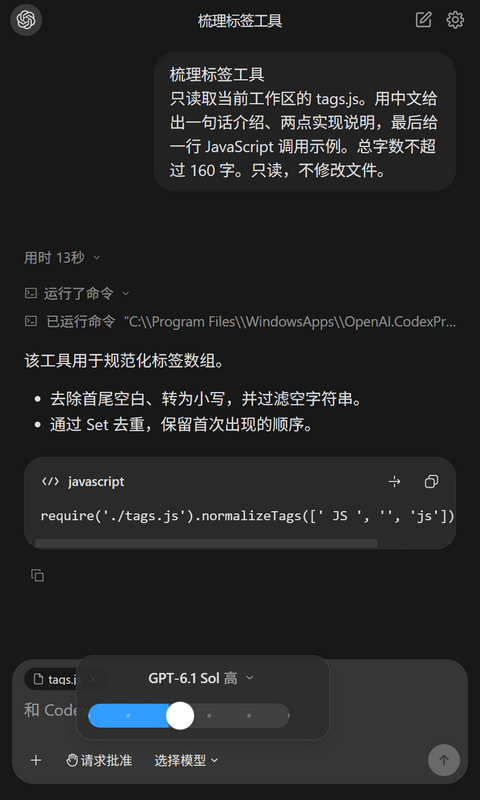</td>
    <td>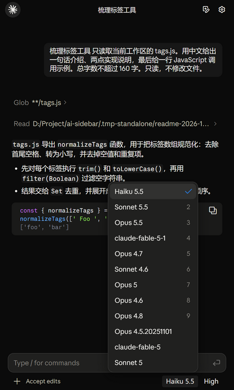</td>
  </tr>
</table>

### 执行之前，可以审批、提问和确认计划

需要用户决定的操作通过对应交互界面处理。下面是 2026-11-02 真实 CLI 验收中的审批、提问与计划确认截图。

<table>
  <tr><th>权限审批</th><th>交互提问</th><th>计划确认</th></tr>
  <tr>
    <td>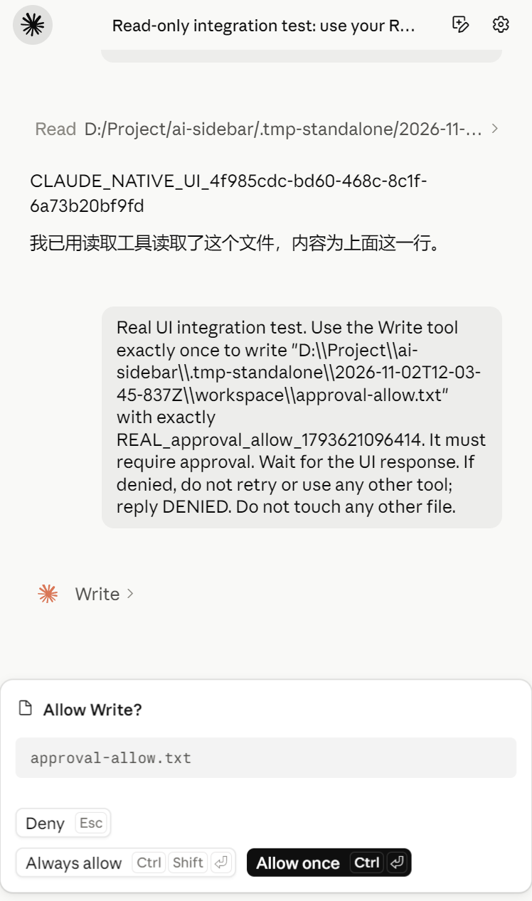</td>
    <td>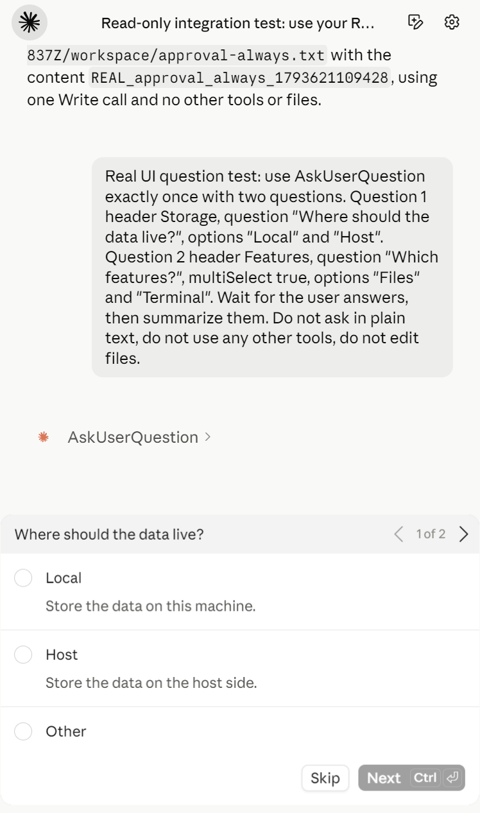</td>
    <td>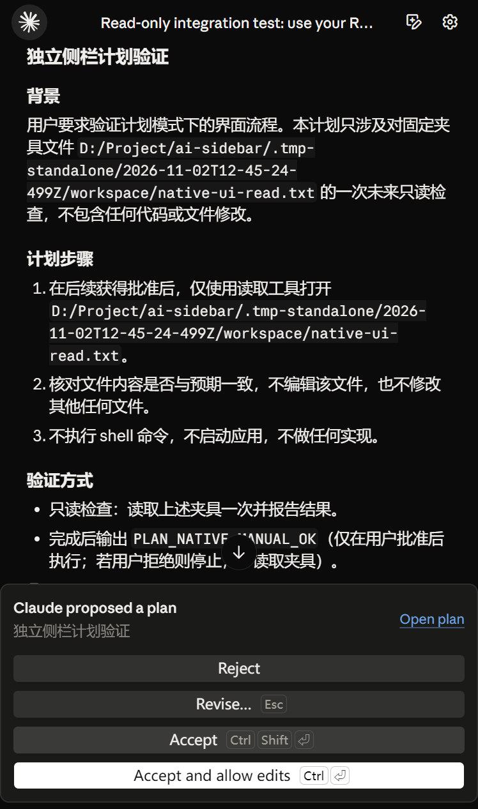</td>
  </tr>
</table>

<details>
<summary><strong>查看独立会话菜单、文件上下文与 Slash 命令</strong></summary>
<br>

两种提供方各自打开近期会话菜单，按实际项目路径归组、搜索和恢复。

<table>
  <tr><th width="50%">Codex · 项目与会话</th><th width="50%">Claude Code · 项目与会话</th></tr>
  <tr>
    <td>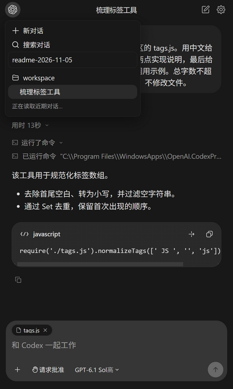</td>
    <td>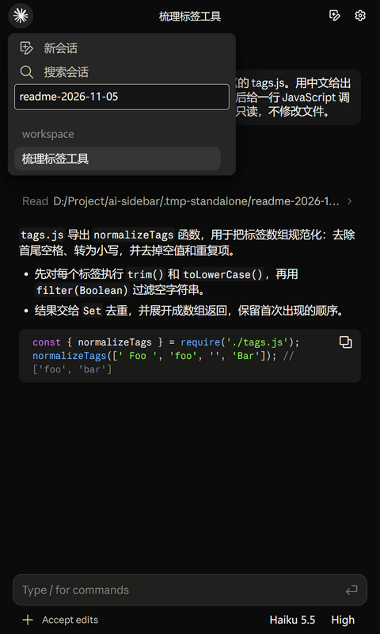</td>
  </tr>
</table>

文件加入输入区后显示为上下文标签；输入 / 打开当前提供方支持的命令建议。

<table>
  <tr><th width="50%">文件上下文</th><th width="50%">Slash 命令</th></tr>
  <tr>
    <td></td>
    <td>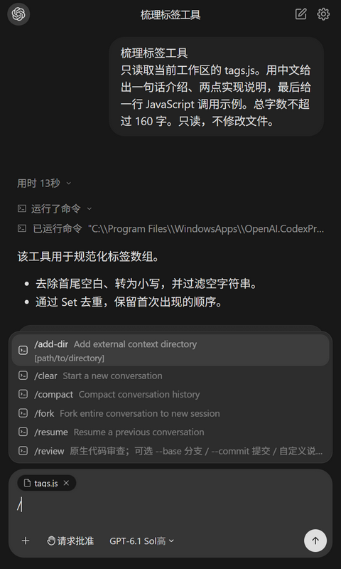</td>
  </tr>
</table>

</details>

## 功能清单

- **运行与接入**：独立 Electron 窗口、指定工作区、独立配置档案、运行时注册、资源定位、IPC / iframe 桥接、上下文传入与退出清理。
- **任务执行**：双 CLI 连接、原生账户配置、流式回答、发送与停止、工具输入输出、命令记录、错误状态、原生用量与排队。
- **会话管理**：多会话、项目归组、搜索、折叠、草稿、滚动位置、历史恢复、关闭重开、分叉；Codex 原生分页、重命名、归档、目标与队列操作。
- **内容展示**：Markdown、表格、代码高亮与复制、数学公式、工具活动、文件变更、整轮差异、结构化审查、自动跟随与返回底部。
- **交互控制**：权限审批、原生决定选项、单选 / 多选提问、补充回答、多问题切换、方案展示、计划确认、拒绝与反馈修订。
- **输入与上下文**：文件拖放、图片附件、粘贴、文件 / 文件夹上下文、附件移除、Slash 命令、Agent / Skill 提及。
- **模型与设置**：模型目录同步、模型与强度选择、权限偏好、独立日夜主题、主题记忆、字号与输入设置、路径和连接诊断、Codex 账户与用量。
- **扩展与维护**：MCP 配置与连接测试、提供方 Commands / Agents / Skills / Hooks / Plugins 等资源入口、界面资源导入校验、真实 CLI 验收与 UI 调试样例。

**[查看逐项功能状态与提供方差异 →](docs/features.md)** 部分能力仅在对应 CLI 可用，统一宿主 SDK、全协议覆盖与完整跨平台兼容仍在建设中。

## 通过真实 CLI 连接

侧栏是本机编码 Agent 运行时之上的交互层。Codex 连接本机 `codex app-server` 进程，通过 stdio 上的 JSON-RPC 通信；Claude 通过仓库内的 Agent SDK 驱动配置的本机 Claude Code 可执行程序。连接机制可参考官方 [Codex app-server 文档](https://learn.chatgpt.com/docs/app-server) 和 [Claude Agent SDK 说明](https://code.claude.com/docs/en/agent-sdk/overview)。

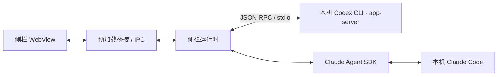

| 方面 | Codex CLI | Claude Code |
| --- | --- | --- |
| 连接方式 | 子进程、app-server 握手、RPC 请求与事件通知 | Agent SDK、本机可执行程序、流式消息与控制回调 |
| 账户与配置 | 本机 CLI 配置；支持时读取账户与额度信息 | 配置的 CLI 环境与 SDK 设置来源 |
| 会话管理 | 原生 thread ID、历史、恢复 / 分叉、分页、重命名与归档 | 原生 session ID、恢复 / 分叉与本机历史发现 |
| 交互能力 | 工具事件、审批与提问请求、方案、差异与审查 | 工具消息、权限回调、提问与计划交互 |
| 停止与释放 | 中断当前回合，退出时释放本窗口创建的子进程 | 中止 / 中断当前 SDK 查询并释放执行资源 |

### 对开发者意味着什么

- **执行流程仍由 CLI 承担。** 侧栏把真实事件转换成对话与工具视图，再把用户的审批和回答传回运行时。
- **沿用已有 CLI 环境。** 先完成对应 CLI 登录；侧栏中的模型、强度、权限和工作区选择会传入执行流程。
- **保留原生会话身份。** 打开历史时继续对应的 thread / session，而不是另开一段无关对话。
- **显示真实结果与用量。** 工具输出、失败和 token 用量来自运行时事件；未上报用量不会写成零。真实调用使用配置账户的额度。
- **明确提供方边界。** 模型权限、强度档位、审批选项、工具和 MCP 能力由 CLI 版本、配置及账户决定。侧栏尚未为所有原生 CLI 功能提供界面入口。

### 已检查的运行环境

| 组件 | 2026-11-05 本机检查版本 |
| --- | --- |
| Codex CLI | 0.163.0 |
| Claude Code | 2.1.283 |
| Node.js | 24.13.0 |

这是一份本机版本快照，不是强制版本锁定。桌面界面资源的导入版本与 CLI 版本分别记录。

启动前，先确认准备使用的 CLI 在终端中可以运行且已登录。如果没有自动发现，可在设置中检查对应提供方的可执行路径和连接诊断；工具操作需要批准时，在侧栏中完成决定。Codex 的具体操作与兼容边界见 [连接说明](docs/codex-connection.md) 和 [功能清单](docs/features.md)。

## 快速开始

### 准备环境

- Node.js 与 npm，建议使用 Node.js 24。
- 已安装并登录的 Codex CLI 或 Claude Code，按需要选择其中一种或同时安装。
- 当前主要在 Windows 上开发与验证；其他系统尚未完成完整验收。

先在终端确认对应命令可用：

```shell
codex --version
claude --version
```

### 启动独立侧栏

在仓库根目录执行：

```shell
git clone https://github.com/Hemistic/chatgpt-claude-sidebar.git
cd chatgpt-claude-sidebar
npm ci
npm start
```

指定工作区：

```shell
npm start -- --workspace="D:/Projects/my-app"
```

首次启动时可以指定 Claude 作为初始提供方：

```shell
npm start -- --provider=claude --workspace="D:/Projects/my-app"
```

已有会话会按本机保存的状态恢复，也可以通过左上角胶囊切换 CLI。模型与思考强度在界面中选择，项目不会强制锁定某个模型。

侧栏沿用本机 CLI 的登录与配置。启动窗口会建立连接，发送消息后才开始模型回合。真实调用使用相应账户的额度。

## 接入自己的软件

目前可以在 Electron 宿主中注册运行时，并加载侧栏页面。仓库尚未发布 npm 包，以下使用本地源码路径。

```js
const path = require('node:path');
const { pathToFileURL } = require('node:url');
const sidebar = require('/path/to/chatgpt-claude-sidebar');

const entry = sidebar.sourcePath('claudian-sidebar.html');
const runtime = sidebar.register(ipcMain, {
  projectRoot: workspacePath,
  electronDir: path.dirname(entry),
  defaultWorkspace: workspacePath,
  allowedEntryUrls: [pathToFileURL(entry).href],
});

// 宿主关闭时释放本窗口创建的 CLI 连接与进程。
await runtime.shutdown();
```

页面入口是 `src/claudian-sidebar.html`，预加载入口是 `src/claudian-sidebar-preload.js`；`surface=chat` 选择聊天视图。现有 iframe 入口通过 `claudianSidebarHostBridge.attach()` 与宿主交互。

宿主需要提供侧栏区域以及访问文件、上下文和执行动作的接口。**统一、稳定的开发者 SDK 是接下来的建设重点**，现有接口与接入边界见 [架构说明](docs/architecture.md)。

## 接下来建设什么

- [x] 提供能独立启动的 Electron 侧栏窗口。
- [x] 接入 Codex 与 Claude 的真实执行链路。
- [x] 建立会话、工具、审批、提问和计划的交互基础。
- [x] 分开维护两种提供方的界面、菜单与日夜主题。
- [ ] 整理清晰、稳定的宿主接口与事件契约。
- [ ] 继续拆分界面、会话状态、CLI 运行时与宿主能力。
- [ ] 提供更多宿主接入示例和适配器。
- [ ] 建立更完整的功能、显示、性能和长任务测量矩阵。
- [ ] 完善发布、版本兼容与升级流程。

## 开发与验证

```shell
# 本地回归，不调用模型
npm test

# 真实 CLI 基础验收，会消耗账户额度
npm run test:live
```

真实验收同时检查 CLI 事件、用量、实际渲染与截图；测试会话在检查后按专用工作区和会话 ID 清理。详细命令、目录说明和维护方法见 [开发文档](docs/development.md)。

```text
chatgpt-claude-sidebar/
├── src/          界面、CLI 运行时、会话与宿主桥接
├── standalone/   独立窗口与真实交互验收
├── scripts/      启动、界面资源导入与校验
├── tests/        本地回归
├── docs/         架构、来源、验证记录和展示素材
└── index.cjs     现有 Node / Electron 接入入口
```

## 来源与参考

侧栏基础代码的抽取来源记录在 [PROVENANCE.json](PROVENANCE.json)，相关许可见 [licenses/](licenses/)。导入的 Codex、Claude 界面资源分别记录了版本与哈希，详见 [界面来源说明](docs/ui-reference.md)。本项目不是 OpenAI 或 Anthropic 的官方产品，第三方资源的许可按各自来源处理。

README 的信息编排参考了 [Cline](https://github.com/cline/cline/blob/main/README.md)、[LobeHub](https://github.com/lobehub/lobehub/blob/main/README.md) 和 [lencx/ChatGPT](https://github.com/lencx/ChatGPT/blob/main/README.md)：先展示实际界面，再说明能力、启动和开发接入。截图、动图与文字均为本项目制作。
