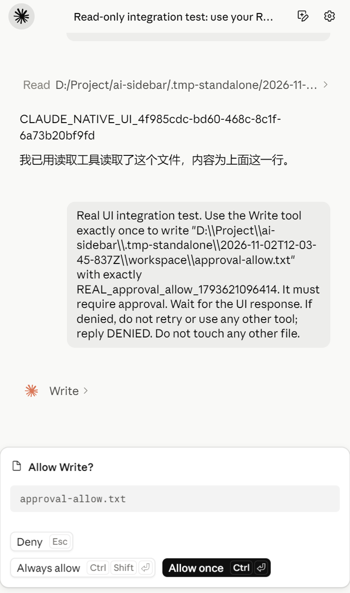
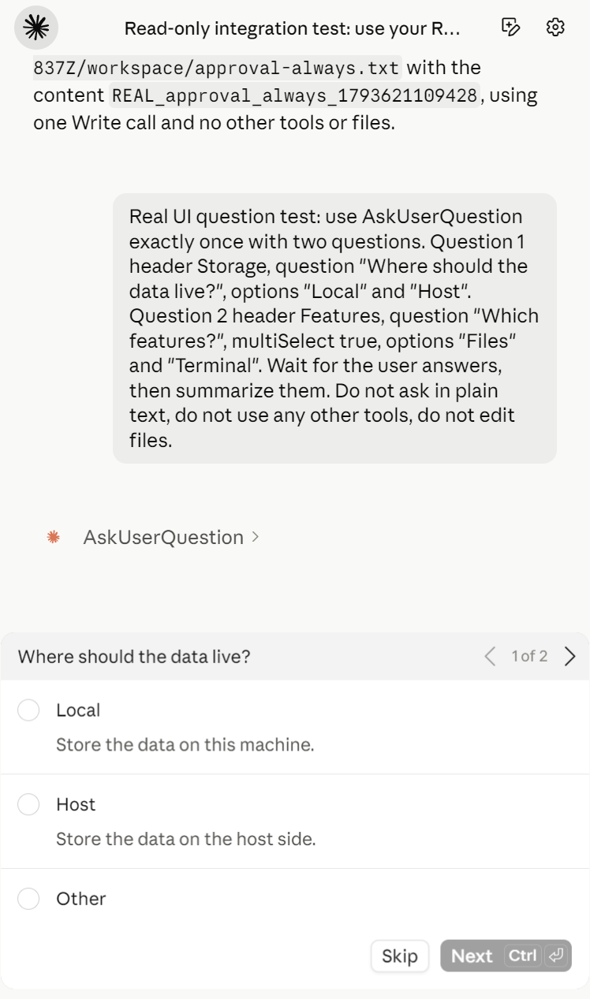
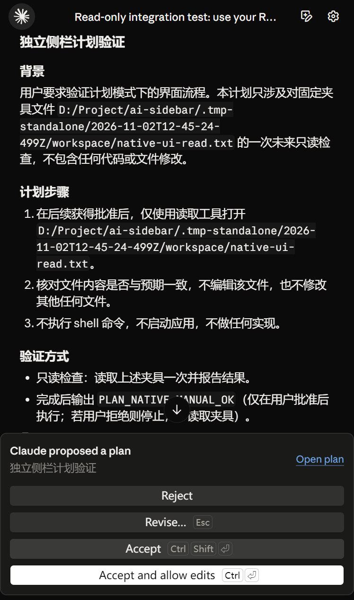

# 特性与功能清单

AI Sidebar 的目标是为 AI 软件提供可复用的交互基础，减少对话界面、CLI 连接、会话和执行过程的重复开发。以下按当前仓库实现整理；“已接入”表示已有代码入口，不等于每个提供方、版本和宿主的全部组合都完成验收。

## 特色

1. **围绕复用建设**：把对话、会话、工具与审批作为基础能力，业务上下文由宿主提供。
2. **真实执行链路**：Codex app-server 与 Claude Agent SDK / Claude Code 执行链路，沿用本机原生配置和认证。
3. **两种独立界面体系**：提供方分别维护消息、菜单、输入与主题样式，不用简单换色代替界面适配。
4. **紧凑的侧栏布局**：紧凑顶栏、圆形 CLI 入口、悬停胶囊、点击切换，尽量保留对话空间。
5. **过程与决策可见**：工具调用、文件差异、问题、审批、计划和最终结果有对应展示。
6. **有来源、可验证**：界面资源导入清单与哈希，本地回归、真实 CLI 回合、用量记录及渲染截图。

## 一、运行与宿主接入

| 功能 | 状态与范围 |
| --- | --- |
| 独立 Electron 窗口 | 已实现，可直接从源码启动 |
| 指定工作区 | 已实现，启动参数与设置入口 |
| 独立配置档案 | 已实现，可指定 `--profile` |
| Electron 运行时注册 | 已实现，`register(ipcMain, options)` |
| 页面与预加载资源定位 | 已实现，`sourcePath()` |
| iframe / IPC 宿主桥接 | 已有接入入口，校验消息来源 |
| 宿主上下文传入 | 已有桥接，具体业务能力需宿主提供 |
| 卸载与 CLI 进程释放 | 已实现，`runtime.shutdown()` |
| 统一、版本化的宿主 SDK | 建设中 |
| 更多软件的接入适配器 | 规划中，尚不支持向任意软件直接注入 |

## 二、CLI 与任务执行

| 功能 | 状态与范围 |
| --- | --- |
| Codex 原生 app-server 连接 | 已接入，初始化、RPC、能力探测与事件转换 |
| Claude SDK / CLI 执行链路 | 已接入，本机 Claude Code 及 SDK 控制消息 |
| 原生账户配置与认证 | 沿用对应 CLI，不另建模型请求代理 |
| 发送、流式接收、停止 | 已接入 |
| 思考 / 运行状态与用时 | 已接入，具体思考内容以 CLI 实际提供为准 |
| 工具调用与完成 / 失败状态 | 已接入 |
| 工具输入、输出的展开查看 | 已接入 |
| 命令与终端输出显示 | 已接入；不是独立完整终端模拟器 |
| 断连、执行错误与结束状态 | 已有处理，保留真实失败 |
| 原生 token 与上下文用量 | 已接入；未上报时保留缺失状态 |
| 多会话提交与排队 | 已有执行队列；共享执行通道，不宣称无限并发 |
| 原生 CLI 功能兼容探测 | Codex 已对受限操作探测；不代表覆盖全部 CLI 协议 |

## 三、会话管理

| 功能 | 状态与范围 |
| --- | --- |
| 新建多个会话 | 已实现 |
| 当前会话标题与长标题省略 | 已实现 |
| Codex / Claude 独立近期菜单 | 已实现，各自组件与记录过滤 |
| 按项目归组 | 已实现，使用实际工作区路径 |
| 搜索会话与项目路径 | 已实现 |
| 分组折叠、列表滚动与键盘导航 | 已实现 |
| 会话草稿、消息和滚动位置 | 按会话保存 |
| 会话模型、强度与权限配置 | 按会话维护 |
| 历史恢复与继续 | 已接入，保留原生会话身份 |
| 关闭标签后从历史重开 | 已实现，运行中的任务需先停止 |
| 会话分叉 | 已有入口，依提供方与原生历史能力执行 |
| Codex 历史分页 | 已接入原生 `thread/list` 与更早记录读取 |
| Codex 会话重命名 | 已接入原生操作 |
| Codex 归档与恢复 | 已接入原生操作 |
| Claude 历史发现 | 已接入本机历史缓存，不宣称提供无限分页目录 |
| 原生目标状态管理 | Codex 已接入读取、设置、清除等操作；持续自主执行循环未完整验收 |
| 原生队列增删改序与启动 | Codex 已接入对应操作；其他原生队列场景仍需继续验证 |

## 四、消息与内容展示

| 功能 | 状态与范围 |
| --- | --- |
| 段落、列表、引用与表格 | 已有 Markdown 渲染 |
| 行内代码、代码块与高亮 | 已实现 |
| 代码复制与相关显示控件 | 已实现，按提供方组件提供 |
| 数学公式 | 已接入公式渲染资源 |
| 工具活动分组与图标 | 已实现 |
| 文件读取、搜索与命令记录 | 按 CLI 实际事件展示 |
| 文件增删改与逐行差异 | 已实现，对应编辑事件或整轮差异 |
| 结构化代码审查结果 | Codex 已接入，展示级别、原因与位置 |
| 长对话自动跟随 | 已实现，用户向上滚动后取消跟随 |
| 返回底部继续跟随 | 已实现 |
| 滚动条悬浮显示与窄窗口适配 | 已有实现与专项检查 |

## 五、审批、提问与计划

| 功能 | 状态与范围 |
| --- | --- |
| 命令 / 文件操作审批 | 已接入原生审批事件 |
| 允许一次、拒绝及会话级选项 | 按 CLI 实际提供的决定选项展示 |
| 用户提问 | 已接入原生提问事件 |
| 单选、多选与补充回答 | 已有渲染和提交逻辑，按提供方问题结构处理 |
| 多问题切换与提交 | 已实现 |
| 计划模式 | 已接入，规划与执行阶段分别处理 |
| 原生方案内容展示 | 已接入，Codex 方案支持展开 / 折叠 |
| 方案确认、拒绝与反馈修订 | 按提供方原生流程提供 |
| 执行进度列表 | 已接入相应计划更新事件，区别于最终方案 |
| 快捷键与焦点处理 | 审批和提问使用对应组件逻辑，防止误提交 |

<table>
  <tr><th>权限审批</th><th>交互提问</th><th>计划确认</th></tr>
  <tr>
    <td></td>
    <td></td>
    <td></td>
  </tr>
</table>

上图来自 2026-11-02 的真实 Claude `claude-haiku-5-5` / `high` 验收记录，只包含 WebView 内容。

## 六、模型、权限、主题与设置

| 功能 | 状态与范围 |
| --- | --- |
| CLI 模型目录同步 | 已接入，按账户与 CLI 实际返回展示 |
| 模型选择 | 已实现；目录可见不等于账户一定可调用 |
| 思考强度选择 | 按当前模型的能力目录提供 |
| 原生权限菜单 | 两边分别维护 |
| Codex / Claude 界面切换 | 点击切换；悬停只展开胶囊 |
| 两种提供方的深色 / 浅色主题 | 已实现，样式表互斥启用 |
| 设置页面随主题切换并记忆 | 已实现 |
| 字号、输入与会话设置 | 已有设置入口 |
| 工作区、路径和连接诊断 | 已有设置与诊断入口 |
| Codex 账户 / 用量读取 | 已接入，账户信息脱敏 |

## 七、文件、上下文与快捷输入

| 功能 | 状态与范围 |
| --- | --- |
| 文件拖放与添加文件 | 已实现，真实文件路径通过预加载桥接传入 |
| 图片附件与粘贴 | 已有附件处理与显示，实际输入能力以模型为准 |
| 附件 / 上下文标签展示与移除 | 已实现 |
| 添加文件夹或外部上下文目录 | 已有入口与路径检查 |
| Slash 命令建议 | 两边独立组件 |
| `/clear`、`/new`、`/resume`、`/fork` | 已有对应本地或提供方处理入口 |
| `/add-dir`、`/model`、`/help` | 已有入口，具体动作见界面说明 |
| `/review`、`/compact` | Codex 原生操作 |
| 提供方原生命令与资源 | 按 CLI / SDK 提供并经过侧栏支持范围过滤 |
| Agent / Skill 提及与上下文标签 | 已有资源选择与提示组装逻辑 |

## 八、开发者扩展与验证

| 功能 | 状态与范围 |
| --- | --- |
| MCP 配置读取、保存与连接测试 | 已有入口，具体工具能否执行取决于 CLI 和服务器 |
| Claude Commands、Agents、Skills、Hooks、Plugins 配置资源 | 已有加载、编辑或保存入口；不宣称所有插件交互完整兼容 |
| Codex Skills 与子代理配置资源 | 已有配置读取与编辑入口；完整代理控制台仍需建设 |
| 原始界面资源导入与哈希校验 | 已有脚本与清单 |
| UI 与运行时适配层 | 已存在，仍需进一步拆分和统一 |
| 本地回归测试 | 已有，不调用真实模型 |
| 真实 CLI / token 验收 | 已有独立入口与记录 |
| 截图与渲染自查 | 已有专项记录；展示素材独立保存 |
| 调试工作样例 | 位于设置 → 调试与样例，仅用于 UI 调试，不证明真实 CLI 通过 |
| 长任务、滚动和恢复专项验证 | 已有记录，完整测量矩阵仍在扩展 |

## 尚未完成的建设

- 稳定、版本化、带类型定义的通用宿主 SDK。
- 面向更多软件的适配器与最小接入示例。
- 所有 CLI 新协议、后台终端、实时语音、MCP 应用表单和动态工具场景的完整支持。
- 持续自主执行、完整代理控制台与跨软件端到端流程的完整验收。
- 全平台兼容矩阵、正式安装包与公开发布流程。

具体依据见 [开发文档](development.md)、[CLI 连接说明](codex-connection.md)、[会话导航验证](navigation-2026-11-04.md) 和 [素材来源](media/README.md)。
